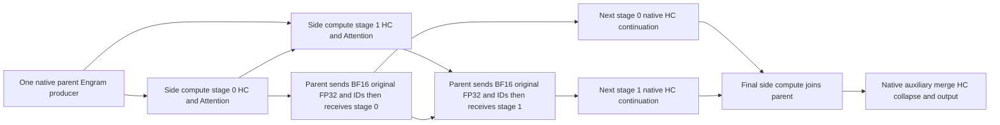
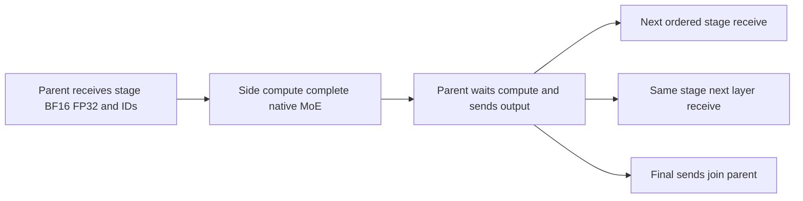
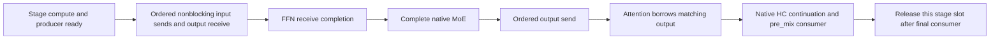

# C6 execution dependencies and native ownership

This map describes C4/C5 ownership and the implemented C6 Graph/eager schedules.
The eager path uses `HcclEagerPipeline`, the native Attention stage driver and
the explicit FFN eager consumer. Their recorded CPU seams and ticket device
probe remain distinct from native full-checkpoint acceptance.
Sources are pinned in `sources.lock.json`; the detailed donor comparisons are
in `graph-five-axis-wire-design-20261110.md` and
`eager-u2-inflight-contract-20261110.md`.

## Graph Attention

D01/D02 map to `HcclGraphComputePipeline`, `DeepseekV41GraphStages` and the
common native parent. Python enqueues all stages' compute, then all stages'
ordered exchanges for each layer. Hybrid stage 0 depends on its own preceding
receive event; hybrid-off records the complete parent frontier. The host still
enqueues every prior-layer exchange before next-layer compute. Final join
precedes auxiliary merge, collapse and output consumption. Native ModelState
alone retires request history; Graph resources retain its original generation.

## Graph FFN

D04 maps to `HcclV41FFNGraph`. Native MoE owns routing, shared experts and TP
reduction. The receive-stream flag adds the same-stage prior-send event;
cross-layer-off also joins every stage's send at the layer boundary. All HCCL
operations physically remain on the parent in this capture family, including
when logical dedicated send/receive choices are configured. Therefore the
current FFN graph does not establish physical receive/compute overlap.

## Eager U2 target

The owner separates posting from consuming and reusing a stage slot,
retains all real Work/event/storage owners, and bounds payload slots by U.
Other stages may post while one stage waits. No caller advances the legacy
transport cursor directly. The existing C4 immediate exchange remains the
serial reference. Independent original FP32 and raw IDs participate in the
same producer, communication and lifetime dependencies as the BF16 activation.
Engram is produced once on A; complete draft DSpark remains A-local.

Attention posts both first-layer stages before consuming the first result.
At a stage's next layer it borrows the preceding output, completes that HC
continuation, then prepares/posts the next layer. Final loans complete before
parent MTP/collapse. FFN posts a stage receive, consumes it on the compute
stream, and posts its output from the parent after closing the input loan.
Every slot reuse waits the real Work handles and its last consumer event.
The normal C4 serial path stays the reference when overlap is disabled or the
native parent is U1/profile/warmup.

The actual-dependency CPU result `five-axis-005` passes 460 cases for the Graph
consumers and settings. Controlled NPU results and full-model acceptance have
separate evidence; this diagram is not either form of runtime acceptance.
