# C6 stream/event source contract, 2026-11-10

Scope: read-only source audit and a proposed implementation boundary. No C6
runtime code, NPU experiment, acceptance result, or performance result is added
by this report. C6 tasks remain unchecked. The production model guard and the
frozen C4/C5 coordinator snapshot are unchanged.

## Exact sources

Donor revision: `4ddd69a391dfb5b3e362c7601399e538a31de702`, inspected with
`git show` from the read-only donor repository. SHA256 values below hash the
original Git blob bytes, not PowerShell-rendered text.

| Source | Git blob | SHA256 |
| --- | --- | --- |
| D01 `afd_plugin/connectors/npu/p2p_hccl.py` | `9863e2475c1867a80605af264f1551ab47bef59e` | `594ac53c8c8008ba05da4d12db1c38511e94fdcb8e13340322a0587e940df0ef` |
| D02 `afd_plugin/model_executor/models/deepseek_v4.py` | `2d33402b611e15d3437ecc93435a7c2bfcaaeb59` | `d513a463d159a0a2c9dae18d566805d1f30a8bb9504909c29c7f1d04bb920d3b` |
| D04 `afd_plugin/v1/worker/npu/ffn_model_runner.py` | `0543da98bd8dc81ddcb3d8d257dce4360c6a2662` | `f95532370a9a5157b16817c5879d78af7405c321d5739d975cd6e2785fe54ccb` |

The target pins remain vLLM `ced6857afa0ea7b2e3f0846a62e1394e90f15607`
and Ascend `7e37e29a7803d6897a7113088e2b771f83205bc0`.

Current target snapshots read during the audit:

| Module | SHA256 |
| --- | --- |
| `deepseek_v41_staged.py` | `62d47c8686f4257047a5290803f88231bdcc83c1ef526a314df60d7a53b12322` |
| `deepseek_v41_graph.py` | `f7520ab3109478469c890d0b07419c1b01b5c6d1e4ef094037d1a7c798c492e7` |
| `hccl_graph_stage.py` | `b55e8dce0a72109bfcceaca52163ac2177ca0d0d6697664af64ed3dd4460a00f` |
| `hccl_v41_ffn_graph.py` | `4ac72eb66c5a3c2142baed6d543a163289ea300236cc3f8ceabd721790f8f459` |
| `hccl_staged_transport.py` | `9ae40a90dab184fc4f1d17f934520318c2bd50eea75b5d082ed284e9a4e79128` |

## Donor call chains and owners

| Contract | Locked source rows | Actual behavior |
| --- | --- | --- |
| Event and logical-stream ownership | D01:175-236, 629-666 | Connector owns per-layer/stage events, send/receive streams and a Graph compute stream. A logical communication stream may resolve to the parent. |
| Eager/Graph selection | D01:595-623, 668-704 | Eager overlap requires U2/DBO and explicitly excludes Graph; Dynamo lowering is separate from later stream/event scheduling. |
| Eager Attention | D01:985-1099; D02:1004-1065 | Send records compute-ready, send stream waits, receive stream waits send-done, and a layer-major caller defers receive consumption until that stage's continuation is needed. |
| Graph Attention | D02:1067-1244; D01:726-807 | Queue both first-layer preparations; parent communication waits the matching compute; next stage compute waits only its own preceding receive in hybrid mode; final continuations join the parent. |
| Parent HCCL | D01:893-923, 945-978, 1241-1317, 1780-1789 | Warmup and capture communication remain on the NPUGraph parent stream even when logical send/receive streams are configured. Compute may fork to a side stream. |
| F-side scheduling | D04:168-193, 825-1218 | Per-stage receive, compute, send events; receive of the next layer waits the same stage's preceding send. Compute waits receive. Send waits compute. Without cross-layer overlap, join sends each layer; otherwise join all final-stage sends. |
| Lifetime | D01:1029-1085, 1241-1317, 1730-1793; D04:1073-1119 | Cross-stream tensors are recorded on consumers. Pending receives retain their tensor/event until consumed; final joins precede return. |
| Switches | D01:239-295, 370-417 | Six strict binary overlap switches default to 1, two diagnostic switches default to 0. CROSS_LAYER requires RECV_STREAM. Graph and eager scheduling are isolated. |

The old donor carries V4 HC continuations. Its tuple/body is not a V4.1 model
implementation. The target must keep `DeepseekV41FFNContinuation`'s residual,
post, comb and pre_mix, native auxiliary observation timing, one parent Engram
producer and native final retirement.

The source establishes scheduling intent and dependencies. It does not prove
that side-stream HCCL or any particular backend wait implementation is safe on
the current target. The Graph parent-stream exception must remain explicit.

## Dependencies to preserve

```mermaid
flowchart LR
  P["One parent producer / input readiness"] --> C["A stage s: prior continuation + Engram + Attention + BF16/FP32 prepare"]
  C --> A["parent: wait compute(s,l), copy BF16 + FP32 + IDs, A2F"]
  A --> R["F parent: recv all three payloads"]
  R --> F["F compute: wait recv(s,l), native MoE / native TP"]
  F --> S["F parent: wait compute(s,l), copy/mask/send output"]
  S --> O["A parent: F2A receive_done(s,l)"]
  O --> N["A compute: continuation(s,l) + next layer(s,l+1)"]
  N --> J["final stage continuation_done -> parent join -> merge / HC collapse"]
```



No stage may consume another stage's event. No next-layer receive may overwrite
a stage bank slot until the prior consumer has finished reading that slot. For
F, the donor's same-stage prior send-done dependency is a conservative sufficient
reuse fence. For A, next-layer compute completion implies its preceding output
has been consumed before the parent can advance to the next exchange.

The target currently has one disjoint bank per positive stage, reused across
layers. This is compatible with one pending continuation per stage, not an
unbounded number of pending layers. Zero-row static stages must record no wire
operations or unrecorded-event waits on either role. Positive padded/zero-valid
stages still execute the agreed fixed shape.

## Current software gaps

1. Target eager `run_deepseek_v41_stages` at lines 166-220 immediately completes
   each layer/stage exchange. Transport lines 853-999 allow only one
   `_pending_inputs` and advance only after the matching output. F has the same
   receive/send cursor. Merely switching current streams does not create a
   supported two-stage in-flight API.
2. Eager input checks read device IDs through `.item()` at transport lines
   844-851 and after F receive. These are real host/device synchronization
   boundaries. A future asynchronous API must preserve ID validation semantics
   and measure this cost rather than silently removing the checks.
3. C5 `DeepseekV41GraphStages.run` at lines 149-187 immediately performs prepare,
   combined `bank.attention_exchange`, and completion. It has no delayed
   continuation/event frontier. F `HcclV41FFNGraph.run` at lines 76-95 is also
   serial on the current stream. Neither body currently provides C6 overlap.
4. `HcclGraphStageBank.attention_exchange` at lines 238-270 copies BF16, FP32 and
   IDs, sends, then receives on the same current stream. Its existing storage
   can support a compute fork, but a caller must wait the actual producer before
   those copies and retain/record all source allocations across streams.
5. C4 COMPLETE's device synchronization is one parent boundary, not a substitute
   for a graph-visible final join. All graph side tasks must have joined the
   parent before native capture/replay returns. A CPU control ACK alone cannot
   retire live device storage.

## Smallest concrete implementation cut

Implement **Graph compute fork/join over parent HCCL first**, as a composed
component with real consumers in the existing A and F graph tensor bodies.
It does not require changing control schema, data process groups, graph keys,
native ModelWithContext, the parent producer, the coordinator, or the C4 cursor.

Proposed new backend-local module:
`afd_plugin/connectors/npu/hccl_graph_pipeline.py`, with a mirrored unit module
and a module-owner validation path. Its retained `HcclGraphComputePipeline`
owns one compute stream and preallocated events for the exact bank
`layer_indices` and `stage_rows`, plus separate final-continuation events.
It is constructed outside capture and retained with the actual graph body/bank;
warmup and formal capture get separate instances through their existing fresh
phase executions. No session registry or mutable global is needed.

Public seams of the initial component, with concrete NPU stream and tensor types:

```python
HcclGraphComputePipeline.allocate(bank: HcclGraphStageBank, *, hybrid=True)
pipeline.run()
    # context manager: one fresh warmup/capture phase, selected parent
pipeline.compute(layer_idx, stage_idx, *, inputs=())
    # context manager: parent-ready or same-stage receive -> side compute
pipeline.attention_exchange(layer_idx, stage_idx, *, tensors=())
    # context manager: parent waits compute; caller copies/sends/receives;
    # record the actual receive completion after that caller body
pipeline.ffn_receive(layer_idx, stage_idx)
    # context manager: prior same-stage send -> caller's parent receive
pipeline.ffn_send(layer_idx, stage_idx, *, tensors=())
    # context manager: compute completion -> caller's parent copy/mask/send
pipeline.final_compute(stage_idx, *, inputs)
    # context manager: final continuation, using separate tail ready/done events
pipeline.join(*, outputs=())
    # parent waits every positive stage tail; retains/records returned outputs
```

The outer body must establish one concrete parent stream for a run. The helper
must reject use on a foreign device/parent or missing stage/layer event before
launching its associated work. It must not reset graph events from a replay
wrapper or read device scalar values. Python validation runs only when building
or executing the body; replay follows the recorded static event DAG.

A consumer change is essential, not an unused event helper:

- A: retain each stage's native continuation; enqueue both first-layer
  preparations; perform existing parent exchanges in unchanged layer/stage/peer
  order; enqueue next-layer compute with that stage's own receive dependency;
  perform final continuations on the compute stream, then join before parent
  auxiliary/MTP reconstruction and HC collapse. Auxiliary observation remains
  at native layer entry. Bind the native shared-Attention child views while
  enqueueing that child's work; bindings are disjoint views, not separate models.
- F: parent receives the existing payload; side compute waits its receive
  event; parent waits compute before existing output copy/mask/send. Maintain
  same-stage reuse fences and join every final send before returning. Native
  shared experts and TP reduction stay inside the existing compute call.

Retain or `record_stream` every crossing allocation, including BF16 activations,
independent FP32 router rows, IDs, positions, Engram lookups/mask, pre_mix,
continuation residual/post/comb, received outputs and shared-expert outputs.
Persistent bank/native input/metadata tensors remain strongly owned by the
existing whole-resource cache. Temporary outputs still need correct allocator
stream ownership; a strong reference by itself is not the complete contract.

This first cut can expose optional explicit pipeline composition at the graph
body constructors, with `None` retaining the current synchronous implementation.
It must not present all six production switches as implemented. A subsequent
policy increment must restore the exact names/defaults/strict values, publish
effective values on all ranks, and reject unsupported dependency combinations.

With current combined A exchanges and parent-only F send/receive, F-side
compute fork alone does not prove receive/compute overlap: the parent may wait
for output before it can receive the next stage. The useful first target is
A's same-stage next-layer compute overlapping the other stage's exchange.
Achieving more overlap needs an explicitly reviewed split exchange order and
progress proof on both roles, not a claim inferred from allocated streams.

For eager/U2, the next separate cut needs transaction-bound pending transfer
tickets and two frontiers: wire submission in agreed layer/stage/peer order,
and per-stage result consumption. A ticket must retain BF16/FP32/IDs/output,
events/work handles, native continuation, and the accepted plan identity until
its last consumer. Reuse, duplicate consume, incomplete drain and next-parent
entry must fail deterministically; fatal partial transfers remain terminal and
retain resources for supervision. Whether the current HCCL send/recv calls
permit useful host progress must be measured, not inferred from a stream scope.

## Validation boundary and cost

CPU seams may assert the observable record/wait/HCCL dependency trace, same-stage
event identities, unchanged payload order and numerical arithmetic outputs,
final joins, zero-stage skips, all-off behavior and public rejection outcomes.
Shared fakes belong under `tests/unit/fakes`; no CPU fake is device acceptance.
Tests must exercise the A/F consumers, not only a schedule object that has no
caller. Keep parent producer/ModelState retirement observable and single-owned.

The first NPU component probe should use the existing actual graph endpoints
and bank, real streams/events, controlled tensor arithmetic, U2 with two layers,
positive/zero-valid/static-zero rows and independent FP32/IDs. Capture and repeat
replay, switch buckets, test allocator pressure, and verify storage/output values
with all-off and compute-fork modes. It should retain all event/buffer owners
until graph reset. Native TP2 additionally verifies unchanged collective order.
Only a real A/F timeline can establish overlap. Full V4.1 HC/Engram/SFA/FP4
checkpoint equivalence and throughput require their own later model evidence.

Expected incremental cost: one compute stream per role, O(layers*positive
stages) event objects plus O(stages) tail events, event records/waits, and retained
per-stage continuations/temporaries. The first cut need not allocate additional
wire banks. Parent completion synchronization remains once per transaction;
no per-layer device synchronize is introduced. Exact HBM and graph/task pool
cost still require measurement.

Removal/upstream direction: use native stage-aware compute/event/remote-expert
hooks once they preserve the same parent capture stream, per-stage metadata,
producer and final-join ownership. No upstream source changes are proposed.

## Initial component candidate

The new composition module and host seams are implemented; actual model-body
consumers remain a separate reviewed change. No existing graph model,
coordinator, main runner or C4 transport was edited for this candidate.

- `afd_plugin/connectors/npu/hccl_graph_pipeline.py`:
  `12eab892912906240d116ac064e8bc1b449b7a8a278433547143f6e1041f7bfd`.
- `tests/unit/fakes/hccl_graph_pipeline.py`:
  `cd0b8707a497465523ca2ca1185b019c3156ec54f1bedde6a87390fa59cb307f`.
- `tests/unit/connectors/npu/test_hccl_graph_pipeline.py`:
  `44250a7e148076822d053e26549b4a4d09b82b119c0b32020ce3e8bf555c978a`.

Ruff and Python compilation passed. The local targeted pytest command skipped
the module because torch is absent (one skipped, exit 1); this is only a CPU
collection boundary, not a behavior pass. A3 immutable snapshot
`a3-pipeline-cpu-20261110/component-001` subsequently passed **31 cases,
14 warnings, zero failed/error/skipped, 1.06 seconds**, exit 0, with
`source_files_match=true` and no device probe. Its identity manifest matches
all three candidate hashes above. This does not validate the subsequent TLS
helper or real model-body consumer increment. Existing `connector_contracts.md`
validation paths cover both the mirrored tests and shared fakes.

The root review found that a non-hybrid final continuation also needs the
parent's whole-layer communication frontier. This is implemented with distinct
typed tail `ready` and `done` events. Non-hybrid tails record/wait parent-ready;
hybrid tails wait their own final receive. The API enforces canonical host
construction: prepare every stage in a layer, enqueue all its communication,
then enqueue the next layer's compute. The host recorder rejects event
re-recording; each warmup or formal capture uses a fresh pipeline instance.

Self-review also removed an unbounded retention list. The component retains
only the latest declared tuple per stage and final outputs. Earlier allocations
already have their real consumer stream recorded before that stage frontier is
replaced. CPU weak-reference tests observe per-stage retention/release and
sticky failure ownership; only an NPU allocator-pressure probe can validate
device reclamation correctness.

The scheduling policy is a capture constant. Read-only hybrid/compute-stream
properties and immutable event mappings do not add a new cache key. Before model
integration, its owner must fix one policy for the session/cache/manager
lifetime; a physical graph key must not select a graph captured under a
different stream policy. Changing policy requires fresh owners. A generation
miss does not authorize recapturing an existing native graph key. The six
production switches are not exposed or claimed
as implemented by this component.

Independent state-audit review of `12eab892` found no remaining hard finding in
this standalone component's event DAG, parent HCCL scopes, stage reuse fences,
single-use events, final join and bounded failure retention. This is a source
review, separate from the actual-dependency CPU snapshot and device
acceptance.

One additional native-consumer boundary remains to audit at integration:
vLLM's locked `utils/torch_utils.py:792-848` caches `current_stream()` in thread
local state, updated by its patched `torch.cuda.set_stream`. A
`torch.npu.stream` context alone does not establish that this cache is updated.
The existing AFD `NPUUBatchContext.update_stream` in
`compat/patches/npu/mrv2_ubatching.py:53-57` explicitly synchronizes that TLS.
The inspected pinned V4.1 model/Engram, DSA V4.1 and native fused-MoE/shared-expert
paths use `torch.npu.current_stream` at their event boundaries; that does not
prove that every reachable native helper ignores the vLLM cache. Actual model
consumers must audit those helpers and, where needed, scope and restore the
existing native TLS rather than add a global registry. This standalone CPU
arithmetic component does not qualify native TP/kernel stream ownership.
